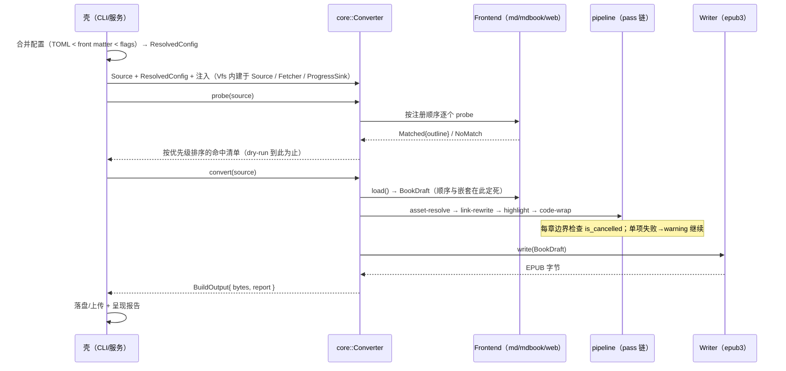

# trans-epub 架构总览

本文是架构文档的入口：先建立拓扑与数据流的整体图景，再按需进入各组件文档。

## 文档地图

| 文档 | 内容 | 对应组件 |
|---|---|---|
| [10-contracts.md](10-contracts.md) | 公共契约：输入源、IR、输出、错误、进度、配置 | trans-epub-contract |
| [20-core.md](20-core.md) | 转换内核：Converter 门面、pass 链、DOM 策略、确定性 | trans-epub-core |
| [30-frontends.md](30-frontends.md) | 源归一前端：md / mdbook / web | core 内 frontends 模块 |
| [40-fetch.md](40-fetch.md) | 礼貌抓取与页面发现 | trans-epub-fetch |
| [50-writer.md](50-writer.md) | EPUB3 写出器与 CSS 主题 | core 内 writer 模块 |
| [60-cli.md](60-cli.md) | CLI 薄壳：装配、配置合并、接线 | trans-epub-cli |

## 设计目标（继承需求定稿 v1.0）

- **编程文档保真**：构建期语法高亮、代码长行处理、mdBook 语义不拍平、链接改写——这是差异化所在。
- **服务就绪**：core 是纯转换库——同步内核、所有 I/O 注入、协作式取消、结构化报告。第三期网络服务是独立仓库的壳层，core/fetch/contract 届时零改动。
- **开闭原则**：新输入格式 = 新前端实现；新处理 = 新 pass；新输出 = 新 writer。三者互不波及，绝不在已有类型上做全处 match 的修改。
- **确定性**：相同输入产出字节级可复现的 EPUB（golden 回归与服务化缓存都依赖它）。
- **一次性全量、无状态、无缓存**：重跑即重来（需求定稿决策，恰好也是服务友好的）。

## crate 拓扑

```text
┌────────────────────────── 壳层：装配与注入 ──────────────────────────┐
│  trans-epub-cli（一期）   GUI（二期）   Web 服务（三期·独立仓库）      │
└─────────┬────────────────────┬───────────────────┬─────────────────┘
          │ 配置合并 / Source 构造 / I/O 注入 / 产物处置
          ▼
┌───────────────────────────────────────────────────────────────────┐
│                 trans-epub-core（转换内核 · 同步纯库）                │
│                                                                   │
│   Converter 门面：probe → load → pass 链 → write                    │
│                                                                   │
│   ┌───────────────────┐  BookDraft  ┌──────────────┐              │
│   │ frontends          │ ─────────▶ │ pipeline      │ ──▶ writer   │
│   │ md / mdbook / web  │   （IR）    │ asset-resolve │  （epub3）   │
│   └───────────────────┘            │ link-rewrite  │              │
│                                    │ highlight     │              │
│                                    │ code-wrap     │              │
│                                    └──────────────┘              │
└─────────┬─────────────────────────────────────────────┬───────────┘
          │ 依赖（trait 与类型都定义在 contract）          │ ✗ 永不依赖
          ▼                                             │
┌──────────────────────────────┐    ┌───────────────────┴────────────┐
│  trans-epub-contract（契约）   │◀───│       trans-epub-fetch          │
│  Source / Vfs / FetchedPage  │    │  默认 Fetcher：robots/限速/重试   │
│  Fetcher / IR / Frontend     │    │  页面发现：列表/sitemap/同域递归   │
│  Writer / Progress / Error   │    │  被 CLI 与服务使用，core 不感知    │
│  ResolvedConfig              │    └────────────────────────────────┘
└──────────────────────────────┘
```

| crate | 职责 | 主要依赖 |
|---|---|---|
| trans-epub-contract | 全部跨 crate 类型与 trait：Source/Vfs/FetchedPage/Fetcher/IR/Frontend/Writer/ProgressSink/BuildError/ResolvedConfig | 仅 serde / url / thiserror 一级 |
| trans-epub-core | 转换内核：三前端实现、pass 链、EPUB 写出器、Converter 门面 | comrak / syntect / syntect-assets / scraper / zip |
| trans-epub-fetch | 默认 Fetcher 实现（PoliteFetcher：robots / 限速 / 重试 / 大小上限）+ 页面发现三机制（URL 列表 / sitemap / 同域 BFS） | reqwest / texting_robots / scraper / globset |
| trans-epub-cli | 壳：参数解析、配置合并、I/O 注入、落盘、报告呈现 | clap / indicatif |

### 依赖红线（架构不变量）

1. **core 永不依赖 fetch**，依赖方向只能是 fetch → contract。采集永远可替换，转换内核不感知采集的存在——这是"获取与转换分离"的结构保证。
2. **contract 不依赖任何兄弟 crate**。契约 crate 存在的理由就在这：fetch 若要实现 core 里的 trait，就会拖进整个转换内核（comrak/syntect/scraper 全家桶）；把接口物理隔离后，fetch 只需轻量契约。
3. **壳层是唯一组装点**。配置优先级合并（TOML < front matter < CLI flags）、Vfs/Fetcher/ProgressSink 的注入、产物落盘/上传，只发生在壳层；core 收到的永远是已合并的 `ResolvedConfig` 与已注入的 I/O 实现。
4. **core 对外只暴露 Converter 门面与契约重导出**。scraper 等 DOM 类型不出 core（详见 20-core.md 的 Pass 归属论证）。

## 一次转换的端到端流程



关键交互约定：

- **probe 与 load 分离**。probe 只做识别与章节清单（Outline），不做内容转换——dry-run、GUI 结构预览、服务的"先确认目录再出书"都只消费 Outline。load 才产出完整 BookDraft。
- **前端优先级 = 注册顺序**。默认顺序 mdbook → md → web（三前端全量落地：探测到 book.toml / src/SUMMARY.md 即由 mdbook 接管）；md / mdbook 只吃 Vfs 源、web 只吃 `Source::Pages`，天然无冲突。多个前端命中是正常现象，取第一个，其余作为信息呈现。
- **pass 链顺序是契约的一部分**（见 20-core.md 的顺序表），新 pass 必须声明插入位置并更新该表。
- **失败双轨**。致命错误（源不可读、无前端可识别、用户取消）走 `Result::Err` 中止；单项失败（某图片拉不下来、某链接解析不了）记 warning 继续跑，结尾随 BuildReport 汇总——服务需要机器可读的报告。

## 服务化接缝（三期，独立仓库）

core 从第一天按服务友好的姿势写。服务化 = 换壳，core/fetch/contract 不动：

| CLI（一期）的职责 | Web 服务（三期）里的对应物 |
|---|---|
| 读磁盘 / 命令行参数 | HTTP 接收上传文件与任务参数 |
| TOML 配置合并 | DB/JSON 配置解析，产出同一个 ResolvedConfig |
| 磁盘 Vfs | 内存 / 对象存储 Vfs（实现 contract::Vfs） |
| fetch crate 礼貌抓取 | 复用 fetch 作底层客户端（上面加队列/调度），或换成服务自带实现（实现 contract::Fetcher） |
| 终端进度条 | ProgressSink → WebSocket/SSE 推送 |
| 落盘 .epub | 上传对象存储 / 随响应回传 |

同步 CPU 密集的 core 在服务侧用 `spawn_blocking` 包裹执行；协作式取消（`is_cancelled` 检查点）让服务能超时中止。

**外置渲染器接缝**（SPA 等非目标场景的预留）：任何能产出 `FetchedPage` 列表的外部工具（headless 浏览器、付费渲染服务）都能直接喂 web 前端，core 无需任何改动。

## 与需求路线的映射

| 阶段 | 增量 | 涉及组件 |
|---|---|---|
| MVP1（≈40%） | Vfs/IR/错误/配置契约；md 前端；pass 链 v1（asset-resolve / link-rewrite / highlight / code-wrap）；epub3 writer；CLI 最小闭环 | contract + core + cli |
| MVP2（+15%） | mdbook 前端（契约零变更） | core |
| MVP3（+25%） | fetch crate 成型 + web 前端（输入侧新增 Pages 消费端，契约不变） | fetch + core |
| 二期 GUI | 壳层新增；结构预览即 probe 的 Outline | 壳层 |
| 三期服务 | 独立仓库的壳层 | 壳层 |

## 落地进度与待办

- ✅ 2026-10-24：crate 改名完成（mdepub-core / mdepub-cli → trans-epub-core / trans-epub-cli，git mv 保留历史）；trans-epub-contract 落地（契约类型 + 单元测试，原 ir.rs 迁入并删除）。
- ✅ 2026-10-24：**MVP1 主线落地**——md 前端（六规则探测 + comrak 方言 + heading id + 资产登记）、pipeline 四 pass（asset-resolve / link-rewrite 含锚点校验 / highlight / code-wrap）、converter 门面、epub3 writer（确定性 zip + CSS 主题亮暗两套）、CLI 最小闭环（配置合并 / dry-run / 报告 / 退出码 / 内置 Fetcher）、质量设施（contract test-util mock、3 本 golden 样书字节级回归、epubcheck 门全绿、真机抽验清单）。验收口径达成：epubcheck 5.2.1 对三本 golden **零错误零警告**。
- ✅ 2026-10-25：MVP1 真机抽验通过（Readest / SumatraPDF）；MVP2 mdBook 前端落地（SUMMARY 自解析不拍平 + 指令展开，契约零变更）。
- ✅ 2026-10-25：**MVP3 落地**——trans-epub-fetch crate（PoliteFetcher + 页面发现三机制）、core web 前端（选择器预设 + language class 存活 + 编码链）、link-rewrite 的 Url 世界解析、CLI crawl 子命令（CLI 内置 Fetcher 已按计划平移进 fetch crate）。golden 第 5 本（web），epubcheck 全绿。
- ✅ 2026-10-25：发布准备第一波——License 定为 AGPL-3.0-only（[ADR 0012](../adr/0012-license-agpl.md)）、分发定为 GitHub Releases 二进制且 crates.io 暂缓（[ADR 0013](../adr/0013-distribution-github-releases.md)，reqwest TLS 随之从 native-tls 切 rustls+ring，交叉零 C 依赖）、用户手册 `docs/guide/` 与根 README 落地（CLI 旗标全表单一事实源移至 guide/cli.md）。
- crates.io 名称可用性确认：暂缓非放弃（需求文档遗留的 Open Question，被 [ADR 0013](../adr/0013-distribution-github-releases.md) 替换为 GitHub Releases 分发；上架时按其两条路径另立决策）。
- 本目录文档与代码同步演进：**契约变更须先改 10-contracts.md 再动代码**，golden 样书随之更新。
